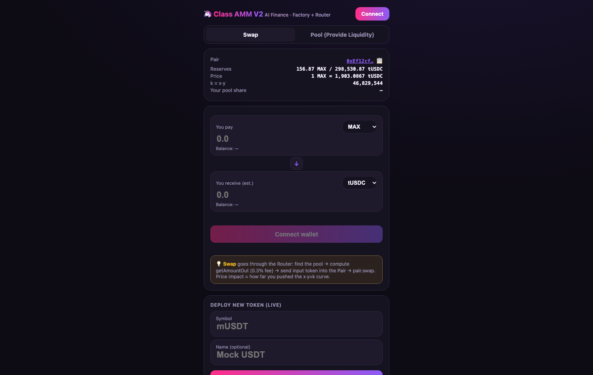
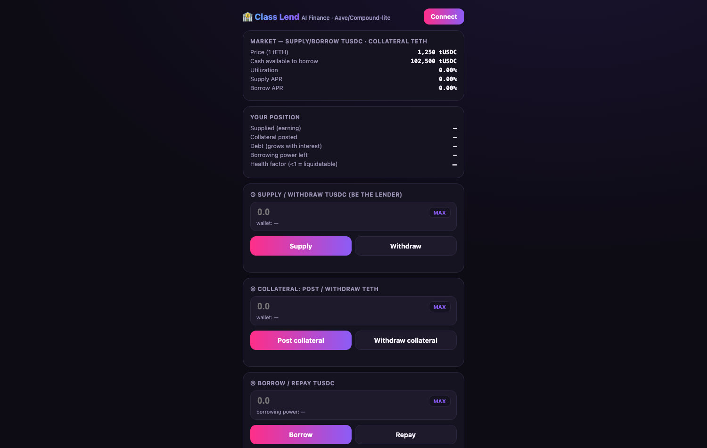
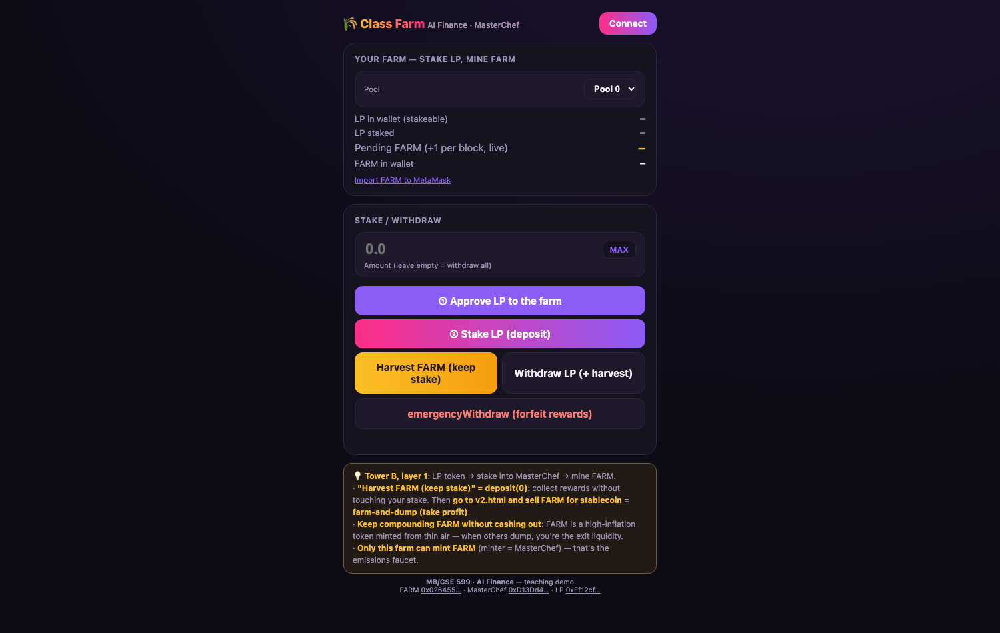
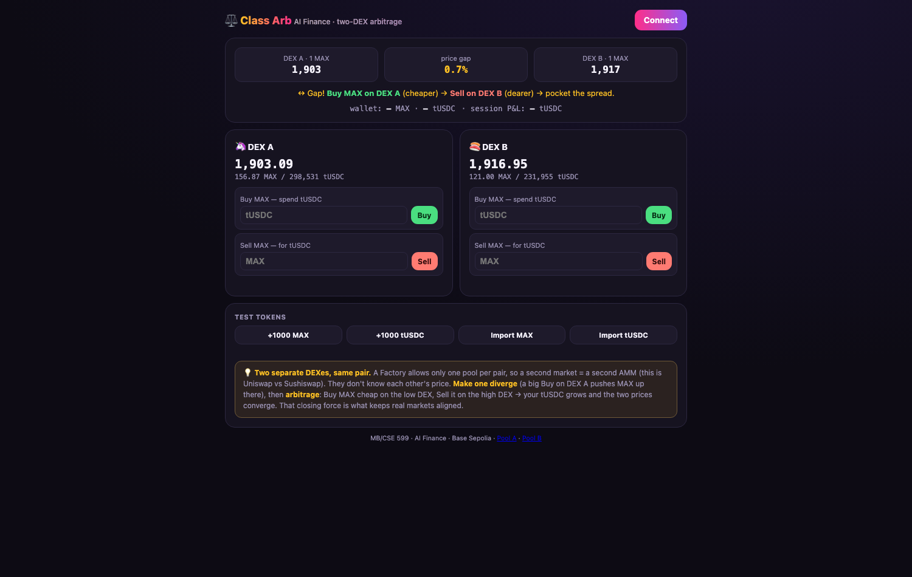
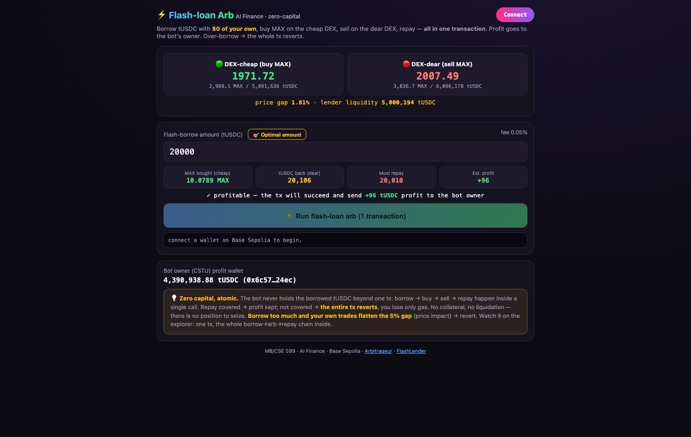
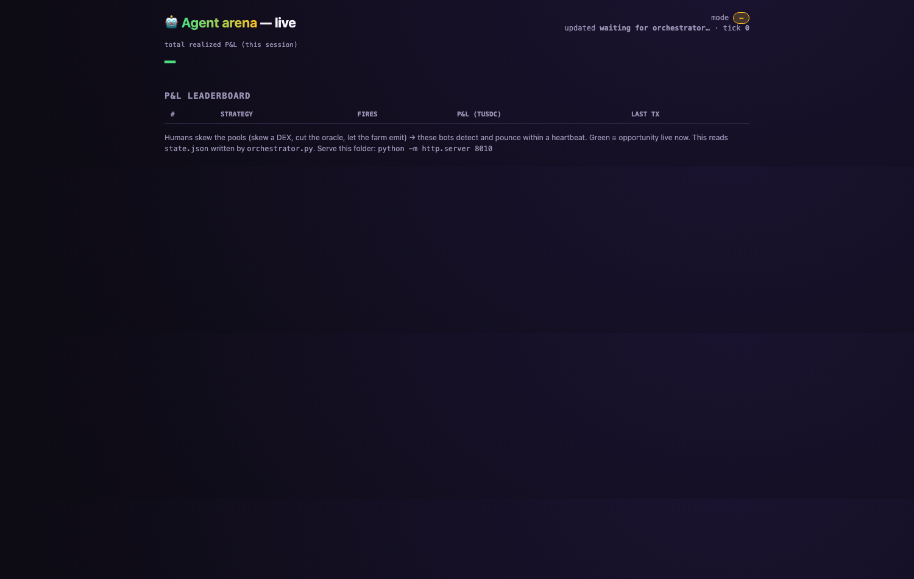
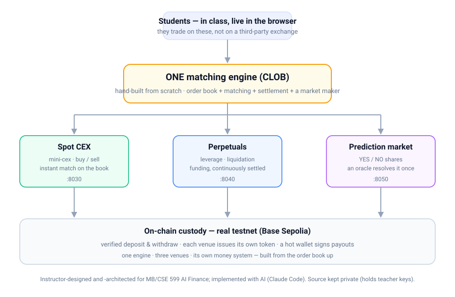
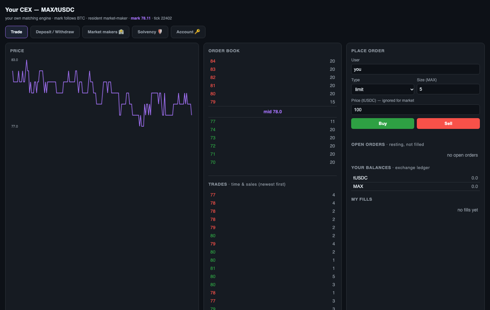
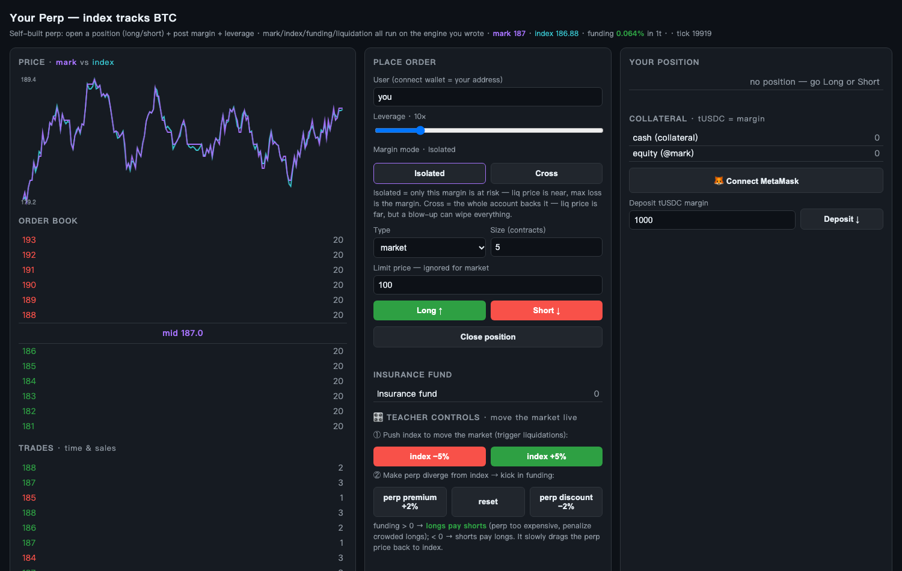
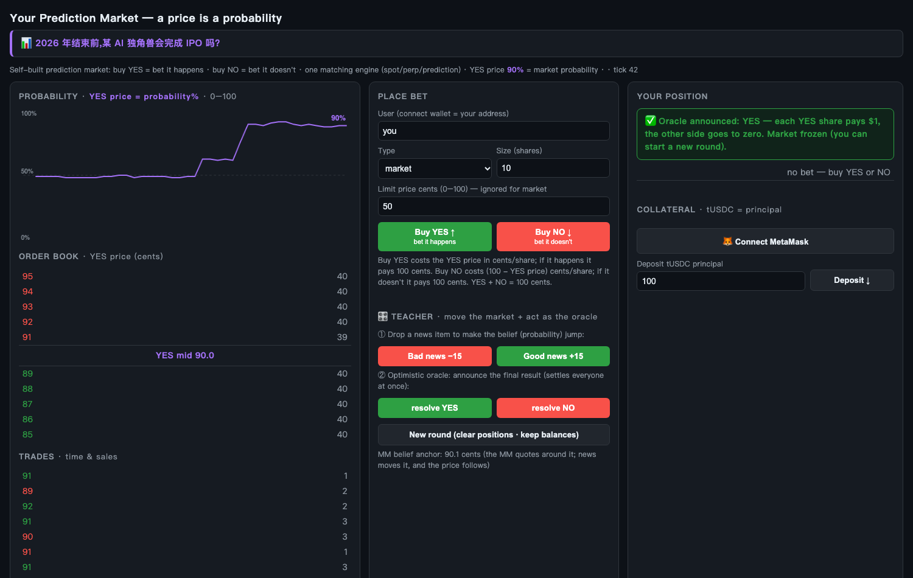

# Built from scratch — the on-chain stack, by hand

Almost everything students touch in this course was **built from scratch** — not wrappers around someone else's API. Two layers:

1. **DeFi primitives you can click right now** — live, interactive, in your browser.
2. **Three exchanges on one engine** — a full spot CEX, perpetuals, and prediction market (source kept private; screenshots below).

---

## 1 · DeFi you can click (live on GitHub Pages)

Open any of these and poke it — they run in the browser, no install.

### AMM / DEX — constant product `x·y=k`
Swap against a pool and watch slippage grow with trade size. → **[Open it ↗](https://aaron-recompile.github.io/AI_Finance/week-02/app/v2.html)**

### Lending & liquidation — the health factor
Supply collateral, borrow against it, watch the health factor fall and trigger a liquidation. → **[Open it ↗](https://aaron-recompile.github.io/AI_Finance/week-02/app/lend.html)**

### Yield farming — mine & dump
Emissions, APY, and why a reward token's price falls as everyone farms and sells. → **[Open it ↗](https://aaron-recompile.github.io/AI_Finance/week-02/app/farm.html)**

### Two-DEX arbitrage
Same asset, two prices — buy low on one pool, sell high on the other, and your trade closes the gap. → **[Open it ↗](https://aaron-recompile.github.io/AI_Finance/week-03/app/arb.html)**

### Flash-loan arbitrage — zero capital, one transaction
Borrow, arbitrage across a deep and a shallow AMM, and repay — all atomically, or the whole thing reverts. → **[Open it ↗](https://aaron-recompile.github.io/AI_Finance/week-03/app/flashloan.html)**

### Agent arena — on-chain bots competing live
Five deterministic bots watch the pools and pounce the instant an opportunity appears; a live dashboard shows their P&L. Runs in the lab (`pip install web3` → `./student_start.sh`, read-only).

---

## 2 · Three exchanges, one engine

A single matching engine (an order book you can read line by line) powers three venues, each with **its own token** and **real testnet deposit/withdraw**. Students traded on these **live, in class**.

**Spot CEX** — buy/sell with instant matching; a background market maker keeps the book alive.

**Perpetuals** — leverage, liquidation, and funding settled continuously; a teacher control can move the market live.

**Prediction market** — YES/NO shares where the price is the probability; an oracle resolves the event once.

---

## Why some source isn't here

The DeFi dApps above are public — click and read them. The **three exchanges** are the course's private teaching infrastructure: they hold teacher wallet keys and run the live deposit/withdraw a class depends on, so students get the **running product**, not the source.

## Honest note

Designed and architected by the instructor for **MB/CSE 599 AI Finance**, and implemented with AI (Claude Code). The point was never to hand-type every line — it was to understand each mechanism (AMM math, health factors, flash loans, order-book matching, funding, liquidation, oracle resolution, on-chain custody and token issuance) well enough to build the whole thing from the ground up and teach it. The [`week-02`](../week-02/)–[`week-07`](../week-07/) code shows the rest.
